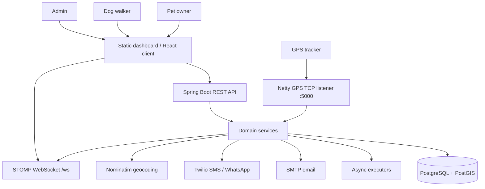
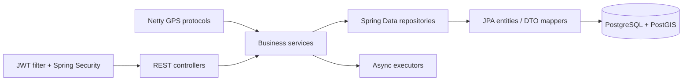
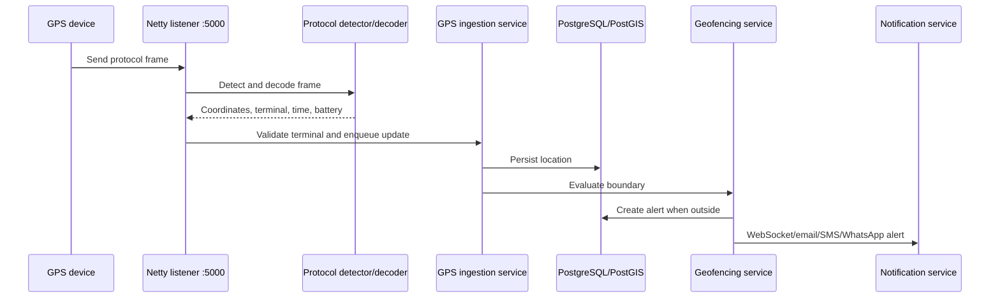
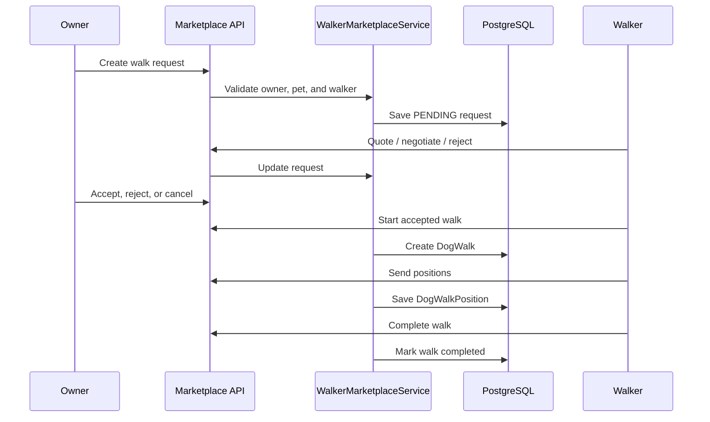
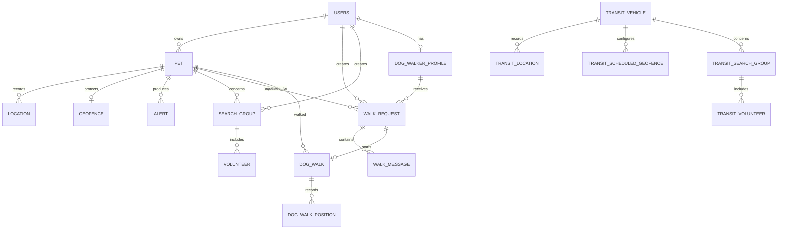

# FiruApp

FiruApp is a pet-care platform that combines GPS pet tracking, geofencing, lost-pet coordination, and a dog-walking marketplace. This repository contains the Spring Boot backend, a browser dashboard served by the backend, the GPS device listener, notification integrations, and the transit-tracking module.

The project is still evolving. This README documents the functionality that exists in the codebase today and identifies the pieces that are planned but not implemented.

## Technology stack

| Layer | Technology |
| --- | --- |
| Runtime | Java 21, Spring Boot 3.3.1, embedded Tomcat |
| HTTP/API | Spring MVC, JSON DTOs, multipart upload handling |
| Security | Spring Security, JWT, BCrypt |
| Persistence | Spring Data JPA, Hibernate ORM/spatial, MapStruct |
| Database | PostgreSQL 15-compatible with PostGIS and JTS geometry |
| Device ingestion | Netty TCP, V41/JT/T 808, ASCII bracket, and Topin decoders |
| Real-time | Spring WebSocket with STOMP/SockJS and an in-memory broker |
| Async work | Spring `@Async`, scheduled jobs, bounded executors, Caffeine caches |
| Notifications | Spring Mail/SMTP, Twilio SMS and optional WhatsApp |
| Browser UI | HTML, CSS, vanilla JavaScript, Leaflet, switchable FiruApp theme |
| Delivery | Docker, Railway, Docker Compose for local PostGIS/Redis |

Spring Kafka is included as an optional/scaffolded ingestion path, but the default GPS path is direct Netty-to-service processing.

## Product capabilities

| Area | Current functionality | Main users |
| --- | --- | --- |
| Accounts | Registration, login, BCrypt password hashing, JWT sessions, role-based access | Owners, walkers, admins |
| Pet profiles | Pet CRUD, tracker/IMEI binding, profile images, active/lost/found status | Owners, admins |
| Pet tracking | Latest location, history, bounded routes, date-range routes, neighborhood lookup, weekly walking distance | Owners, admins |
| GPS devices | JT/T 808 and V41 decoding, ASCII bracket frames, Topin frames, device acknowledgements, terminal admission | Devices, admins |
| Geofences | Circular and polygon boundaries, immediate latest-location check, boundary alerts | Owners, admins |
| Lost-pet community | Search groups, volunteer membership, lost-pet wall, redacted public group details | Owners, volunteers, admins |
| Walker marketplace | Public walker wall, applications, approval, request, quote, decision, chat, active walk, GPS positions, completion | Owners, walkers, admins |
| Notifications | In-app WebSocket alerts, email, SMS, optional WhatsApp | Owners, volunteers |
| Transit tracking | Vehicles, locations, routes, reports, scheduled geofences, transit search groups and volunteers | Admins |
| Operations | HTTP, database, Hikari pool, and GPS ingestion metrics | Admins |

### Current FiruApp dashboard

The backend serves a responsive Spanish-language dashboard from `src/main/resources/static`:

- FiruApp blue/white theme with a switchable classic theme; the choice is saved in `localStorage`.
- Public approved-walker wall.
- Owner registration and login.
- Demo account shortcuts.
- Owner panel with pet creation/listing and walk requests.
- Walker panel with received requests, quote/status controls, and active/history walks.
- Request detail view with negotiation chat.
- Leaflet map for dog-walk positions and route history.
- Admin panel with walker management and operational metrics.
- Automatic inbox/map/alert refresh while a session is active.

The static dashboard currently focuses on the marketplace workflow. The complete tracking, geofence, lost-pet, and transit capabilities are exposed by the REST API and can also be consumed by a separate React client. A companion React frontend uses the marketplace APIs from its `/walks` route.

## Demo accounts

Demo walker data is enabled by default with `demo.walkers.enabled=true`. On application startup, the service idempotently creates the following accounts and profiles:

| Role | Email | Password | Profile |
| --- | --- | --- | --- |
| Owner | `owner.demo@firuapp.local` | `FiruDemo123!` | Luna, Golden retriever |
| Walker | `camila.walker@firuapp.local` | `FiruDemo123!` | Alto Prado, COP 45,000 base |
| Walker | `mateo.walker@firuapp.local` | `FiruDemo123!` | Riomar, COP 52,000 base |
| Walker | `sofia.walker@firuapp.local` | `FiruDemo123!` | El Prado, COP 40,000 base |

To test the complete request flow:

1. Open the app in a normal browser window and sign in as the demo owner.
2. Choose a walker and create a walk request.
3. Open an incognito/private window and sign in as that walker.
4. Open the received request, quote or negotiate, and send a message.
5. Return to the owner session to accept the proposal.
6. Sign in as the walker again, start the walk, send browser GPS positions, and complete the walk.

The dashboard stores its JWT in `localStorage`, so separate normal and incognito contexts are needed for owner/walker testing.

There is a separate optional GPS demo for the configured `DEMO_ACCOUNT_EMAIL` (default `danico411@gmail.com`). When `DEMO_GPS_ENABLED=true`, a successful login seeds the synthetic pets Peluche, Bella, and Rocky with routes and the scheduled simulator publishes locations and demo geofence alerts.

## Architecture

### Runtime overview



### Backend layers



### Main modules

| Module/package | Responsibility |
| --- | --- |
| `controller` | Authentication, pets, alerts, geofences, lost-pet groups, walker marketplace, admin metrics |
| `transit/controller` | Transit vehicle, geofence, and search-group APIs |
| `service` | Domain rules, access checks, location persistence, notifications, marketplace workflow, caching, demo data |
| `repository` | JPA persistence for core pet, community, and marketplace entities |
| `transit/repository` | JPA persistence for transit entities |
| `entity` | Users, pets, locations, geofences, alerts, search groups, walkers, requests, messages, and walks |
| `transit/entity` | Vehicles, transit locations, scheduled geofences, incidents, groups, and volunteers |
| `gps` | TCP server, protocol detection, ingestion, JT/T 808/V41/Topin support, device replies |
| `security` | JWT generation, bearer-token filtering, BCrypt, role rules |
| `config` | WebSocket, CORS, caches, geospatial support, async executors, Railway validation |
| `static` | FiruApp dashboard HTML, CSS, JavaScript, and Leaflet map integration |

## Functional flows

### Authentication and authorization

1. `POST /api/auth/register` creates a `USER` account with a BCrypt password hash.
2. `POST /api/auth/login` validates the credentials and returns a JWT.
3. The browser stores the token and sends it as `Authorization: Bearer <token>`.
4. `JwtAuthFilter` restores the authenticated principal for each protected request.
5. Service-level ownership checks restrict users to their own pets, routes, geofences, requests, walks, and private groups.

Roles:

- `USER`: pet owner, tracker, geofence, lost-pet, and marketplace consumer capabilities.
- `WALKER`: receive and answer walk requests, chat, start walks, send positions, and complete walks.
- `ADMIN`: walker administration, metrics, full owner scope, and transit administration.

### Pet location flow



Tracker-originated updates are processed asynchronously so Netty event-loop threads do not block on database work. Manual `POST /api/pets/{id}/locations` updates use the same domain pipeline but are persisted synchronously for the API response.

Location records can include latitude, longitude, app-local timestamp, battery percentage, and battery voltage. The default timezone is `America/Bogota`; tracker-specific JT/T 808 zones can be configured by terminal ID.

### Geofence and lost-pet flow

- An owner creates one circle or polygon geofence per pet.
- The latest location is checked immediately when a new geofence is saved.
- Subsequent locations are evaluated asynchronously.
- Out-of-zone events create an `Alert`, notify the owner, publish a real-time alert, and notify active lost-pet volunteers.
- Marking a pet lost/found updates the pet state and integrates with the lost-pet notification flow.
- Search groups coordinate volunteers around a pet and expose a redacted lost-pet wall to normal users.

### Dog-walk marketplace flow



The request includes the pet, requested start time, duration, service address, notes, owner budget, and walker quote. Owners and walkers can chat inside a request. Walk positions are rendered as a Leaflet polyline, and the walker can submit browser geolocation while the walk is `IN_PROGRESS`.

### Transit flow

The transit module is a separate domain inside the same service. Admin-only APIs manage vehicles, their locations, recent routes, time-window reports, scheduled geofences, incident/search groups, and volunteer membership. Transit geofence processing uses its own async executor.

## Data model



Core tables/entities:

- `users`: identity, contact data, password hash, and role.
- `pet`: owner profile, tracker identifiers, status, and image data.
- `location`: pet coordinates, timestamps, and battery telemetry.
- `geofence`: circle or PostGIS polygon for a pet.
- `alert`: boundary and pet events.
- `search_group` and `volunteer`: lost-pet coordination.
- `dog_walker_profiles`: walker marketplace profile and approval state.
- `walk_requests`, `walk_messages`, `dog_walk`, and `dog_walk_positions`: negotiation and walk execution.
- `transit_*`: vehicle tracking and transit incident coordination.

PostGIS is used for polygon geofences and spatial operations. The schema includes indexes for owner access, tracker lookup, time-ordered routes, alerts, marketplace requests/messages, walk positions, and transit locations.

## API surface

All routes below are relative to the application origin. Protected routes require a JWT bearer token unless noted otherwise.

### Public and authentication

| Method | Endpoint | Purpose |
| --- | --- | --- |
| `POST` | `/api/auth/register` | Register an owner account |
| `POST` | `/api/auth/login` | Authenticate and receive a JWT |
| `GET` | `/api/public/walkers` | List active approved walkers |
| `POST` | `/api/walker-applications` | Submit a public walker application |

### Account and pets

| Method | Endpoint | Purpose |
| --- | --- | --- |
| `GET` | `/api/me` | Current user and optional walker profile ID |
| `GET` | `/api/walkers/me` | Current user's walker profile |
| `GET` | `/api/pets` | List accessible pets; supports `page` and `size` |
| `POST` | `/api/pets` | Create a pet as JSON or multipart with image |
| `GET` | `/api/pets/{id}` | Read one accessible pet |
| `PUT` | `/api/pets/{id}` | Update a pet as JSON or multipart |
| `DELETE` | `/api/pets/{id}` | Delete a pet |
| `GET` | `/api/pets/{id}/image` | Read the pet image |
| `POST` | `/api/pets/{id}/lost` | Mark a pet as lost |
| `POST` | `/api/pets/{id}/found` | Mark a pet as found |
| `GET` | `/api/pets/{id}/locations` | Location history |
| `GET` | `/api/pets/{id}/route` | Route from the last three hours |
| `GET` | `/api/pets/{id}/route/range` | Route between `from` and `to` |
| `POST` | `/api/pets/{id}/locations` | Add a manual location |
| `GET` | `/api/pets/{id}/neighborhood` | Resolve the latest neighborhood |
| `GET` | `/api/pets/{id}/walk-distance/week` | Daily walking distance for a week |
| `GET` | `/api/pets/locations` | Latest locations for the current user's pets |

Pet image uploads use `multipart/form-data` with a `pet` JSON part and an optional `image` file part. JPEG, PNG, WebP, and GIF are accepted. The default limit is 20 MB per file and 21 MB for the complete request; configure the limits with `SPRING_SERVLET_MULTIPART_MAX_FILE_SIZE` and `SPRING_SERVLET_MULTIPART_MAX_REQUEST_SIZE`. Oversized requests return HTTP 413.

### Alerts and geofences

| Method | Endpoint | Purpose |
| --- | --- | --- |
| `GET` | `/api/alerts` | List current user's alerts |
| `DELETE` | `/api/alerts/{id}` | Dismiss an alert |
| `POST` | `/api/geofences/circle/{petId}` | Create a circular geofence |
| `POST` | `/api/geofences/polygon/{petId}` | Create a polygon geofence |
| `GET` | `/api/geofences/{petId}` | Read a pet geofence |
| `DELETE` | `/api/geofences/{petId}` | Delete a pet geofence |

### Lost-pet search groups

To upload a group image, use `multipart/form-data` with a `group` part containing
JSON and an optional `image` file part. The response includes `imageUrl`.
The optional `whatsappGroupLink` field accepts HTTPS invitation links from
`chat.whatsapp.com`, `www.whatsapp.com`, or `wa.me`.

```bash
curl -X POST http://localhost:8080/api/search-groups \
  -H "Authorization: Bearer $TOKEN" \
  -F 'group={"petId":42,"groupName":"Find Milo","description":"Search team","status":"active","whatsappGroupLink":"https://chat.whatsapp.com/example"};type=application/json' \
  -F 'image=@milo.jpg;type=image/jpeg'
```

| Method | Endpoint | Purpose |
| --- | --- | --- |
| `POST` | `/api/search-groups` | Create a group for a pet |
| `POST` | `/api/search-groups` (`multipart/form-data`) | Create a group with an optional image (`group` JSON part + `image` file part) |
| `GET` | `/api/search-groups` | List visible groups; supports pagination |
| `GET` | `/api/search-groups/{id}` | Read one visible group |
| `GET` | `/api/search-groups/my` | List groups for the current user |
| `GET` | `/api/search-groups/pet/{petId}` | List groups for a pet |
| `PUT` | `/api/search-groups/{id}` | Update a group |
| `PUT` | `/api/search-groups/{id}` (`multipart/form-data`) | Update a group with an optional image |
| `GET` | `/api/search-groups/{id}/image` | Read the group image |
| `GET` | `/api/search-groups/{id}/messages` | List the group's internal chat messages |
| `POST` | `/api/search-groups/{id}/messages` | Send an internal chat message |
| `POST` | `/api/search-groups/{id}/join` | Join as a volunteer |
| `POST` | `/api/search-groups/{id}/leave` | Leave a group |
| `GET` | `/api/search-groups/{id}/volunteers` | List group volunteers |
| `GET` | `/api/search-groups/{id}/member-candidates` | Find candidate members |
| `POST` | `/api/search-groups/{id}/volunteers/{userId}` | Add a volunteer |
| `DELETE` | `/api/search-groups/{id}/volunteers/{userId}` | Remove a volunteer |

`POST /api/search-groups/{id}/join` does not require a request body. A new or
reactivated membership returns `201 Created`; repeating the request for an
already active member returns `200 OK`. Both responses contain `volunteer`,
`message`, `alreadyMember`, and `reactivated`.

Group chat messages use JSON such as `{ "body": "I am searching the north side." }`.
Only active volunteers, the pet/group owner, and administrators can read or send messages.

### Walker marketplace and dog walks

| Method | Endpoint | Purpose |
| --- | --- | --- |
| `POST` | `/api/walk-requests` | Owner creates a walk request |
| `GET` | `/api/walk-requests` | List requests visible to owner/walker |
| `GET` | `/api/walk-requests/{id}` | Read a request |
| `PUT` | `/api/walk-requests/{id}/quote` | Walker proposes price/status |
| `PUT` | `/api/walk-requests/{id}/decision` | Owner accepts, rejects, or cancels |
| `GET` | `/api/walk-requests/{id}/messages` | Request chat history |
| `POST` | `/api/walk-requests/{id}/messages` | Send a request chat message |
| `POST` | `/api/walk-requests/{id}/start` | Start/resume a dog walk |
| `GET` | `/api/dog-walks` | List visible active/history walks |
| `GET` | `/api/dog-walks/{id}` | Read a walk |
| `GET` | `/api/dog-walks/{id}/positions` | Read recorded walk positions |
| `POST` | `/api/dog-walks/{id}/positions` | Submit a walker position |
| `POST` | `/api/dog-walks/{id}/complete` | Complete a walk |

### Admin

| Method | Endpoint | Purpose |
| --- | --- | --- |
| `GET` | `/api/admin/walkers` | List all walker profiles |
| `POST` | `/api/admin/walkers` | Create a walker directly |
| `PUT` | `/api/admin/walkers/{id}` | Approve/reject, activate/deactivate, or edit |
| `DELETE` | `/api/admin/walkers/{id}` | Delete a walker profile |
| `GET` | `/api/admin/metrics` | Read HTTP, DB, pool, and GPS metrics |

### Transit administration

| Method | Endpoint | Purpose |
| --- | --- | --- |
| `GET`/`POST` | `/api/transit/vehicles` | List or create vehicles |
| `GET` | `/api/transit/vehicles/{id}` | Read a vehicle |
| `POST` | `/api/transit/vehicles/{id}/locations` | Add a vehicle location |
| `GET` | `/api/transit/vehicles/{id}/locations/latest` | Latest vehicle location |
| `GET` | `/api/transit/vehicles/{id}/route` | Recent vehicle route |
| `GET` | `/api/transit/vehicles/{id}/report` | Time-window vehicle report |
| `POST` | `/api/transit/geofences/vehicle/{vehicleId}` | Create a scheduled vehicle geofence |
| `GET` | `/api/transit/geofences/vehicle/{vehicleId}` | List vehicle geofences |
| `DELETE` | `/api/transit/geofences/{geofenceId}` | Delete a vehicle geofence |
| `POST` | `/api/transit/search-groups` | Create a transit search group |
| `GET` | `/api/transit/search-groups/vehicle/{vehicleId}` | List vehicle groups |
| `GET` | `/api/transit/search-groups/my` | Current user's transit groups |
| `POST` | `/api/transit/search-groups/{id}/join` | Join a transit group |
| `POST` | `/api/transit/search-groups/{id}/leave` | Leave a transit group |

### Real-time and device interfaces

- STOMP/SockJS endpoint: `/ws`.
- Owner alert topic: `/topic/alerts/{ownerId}`.
- GPS TCP listener: port `5000` by default.
- HTTP/Tomcat server: port `8080` by default.

## GPS protocol support

The TCP listener detects protocols per connection and routes frames to the correct decoder:

- V41/JT/T 808 with legacy 2011/2013 and 2019 headers.
- JT/T 808 registration (`0100`/`8100`), authentication (`0102`), heartbeat (`0002`), general reply (`8001`), and location (`0200`) handling.
- ASCII bracket frames beginning with `[` and ending with `]`.
- Topin frames beginning with `7878`; valid recent fixes use the shared persistence/geofence pipeline.
- Known-terminal admission: unknown devices receive a failure response and their locations are not ingested.
- Device timestamps are converted using the terminal-specific configured zone and saved using the application timezone.
- HW10/BSJ nested battery records populate `batteryPercent` and `batteryVoltage` when valid.
- The legacy V41 battery extension `E1 01 XX` is supported for 0–100 percent.

The device terminal identifier must match the pet's registered tracker identifier. For JT/T 808, the exact BCD terminal ID from the packet header, including leading zeros, is used. Legacy headers normally contain 12 digits and 2019 headers may contain 20; the terminal ID can differ from the printed IMEI. For Topin, use the 15-digit IMEI.

JT/T 808 device clocks have no transmitted timezone. Configure terminal-specific zones under `gps.jt808.terminal-time-zones`. The observed HW10 terminal `014166272782` defaults to `UTC` through `GPS_HW10_TIME_ZONE`; other terminals default to `APP_TIME_ZONE`. Incoming device times are converted to an instant and stored using the application timezone. Logs containing `JT808 time terminalId=...` show the raw BCD time, configured zone, applied offset, decoded UTC, and server UTC.

HW10/BSJ additional-info item `0xEB` supports nested records. Field `0x00A8` supplies battery percentage and `0x002D` supplies millivolts; valid values populate the location telemetry fields. Field `0x00D5` is decoded as diagnostic reported IMEI metadata and does not overwrite the registered terminal ID. The V41 `E1 01 XX` extension accepts one unsigned 0–100 percentage byte, including zero. Vendor-specific Wi-Fi/LBS layouts, heartbeat battery payloads, batch uploads, encrypted messages, and subpackage reassembly remain unsupported.

For Topin devices, valid recent non-historical fixes use the shared location/geofence pipeline and status packets can supply battery percentage for later fixes on the same connection. Topin replies use the `TRACCAR_COMPATIBLE` profile.

## Security model

Public routes are limited to:

- Static dashboard assets.
- `/api/auth/**`.
- `/api/public/**`.
- `/api/walker-applications`.
- `/ws/**` and `/error`.

All other API routes require a valid JWT. `/api/admin/**` and `/api/transit/**` require `ROLE_ADMIN`. Authorization is also enforced in the domain services so normal users cannot use an ID to access another owner's pets, locations, geofences, requests, walks, or private group data.

Additional security characteristics:

- Passwords are stored with BCrypt.
- JWT sessions are stateless.
- CORS origins are configured through `APP_CORS_ALLOWED_ORIGINS`.
- Lost-pet wall data is intentionally redacted for normal users.
- Production deployments must provide a non-default `JWT_SECRET`.
- Uploads validate image type and configured multipart limits.

## Database and schema lifecycle

The application currently uses PostgreSQL with PostGIS, JPA/Hibernate, and an idempotent `src/main/resources/schema.sql` bootstrap script.

At startup the order is:

1. Spring connects to the configured datasource.
2. `schema.sql` runs because `spring.sql.init.mode=always`.
3. The script enables PostGIS, adds compatible columns/constraints, creates missing marketplace/transit tables, and creates indexes.
4. Hibernate starts with `ddl-auto=validate` and verifies that the database matches the entities; Hibernate does not create tables in the normal configuration.
5. `ApplicationReadyEvent` listeners start the GPS listener and seed demo walkers/owner data.

The current configuration also has `spring.sql.init.continue-on-error=true` for compatibility with existing local databases. SQL failures are therefore logged rather than always aborting startup. The script is idempotent, but it is not a versioned migration system. For production schema evolution, replace or supersede it with Flyway or Liquibase.

`docker-compose.yml` starts PostGIS and Redis. The Docker Postgres init directory only enables PostGIS on a new database volume; the application `schema.sql` is responsible for the application schema during boot.

`schema.sql` is currently a compatibility/bootstrap script, not a complete versioned database baseline. Existing installations must contain the original core tracker tables (`users`, `pet`, `location`, `geofence`, `alert`, and related tables) before Hibernate validation can pass. The script adds the newer marketplace/transit tables and indexes. A fresh environment should be initialized from the project's database baseline or a database dump before starting with `ddl-auto=validate`; using `ddl-auto=update` is intended only as a temporary local recovery/bootstrap option.

## Local development

### Prerequisites

- Java 21.
- Docker Desktop with Docker Compose.
- PostgreSQL/PostGIS, provided by the compose file for local development.

### Start the database

```bash
docker compose up -d postgres
```

Default local database values:

```text
Host:     localhost
Port:     5432
Database: pettracker
User:     petuser
Password: petpass
```

### Start FiruApp

```bash
./gradlew bootRun
```

Open [http://localhost:8080](http://localhost:8080).

Useful local commands:

```bash
./gradlew compileJava
./gradlew test
node --check src/main/resources/static/app.js
git diff --check
```

The full integration context requires a reachable PostgreSQL/PostGIS database. The GPS listener uses port `5000`; change `gps.listener.port` or `GPS_LISTENER_PORT` if another process owns it.

### Build and run the Docker image

```bash
docker build -t firuapp .
docker run --rm \
  -p 8080:8080 \
  -p 5000:5000 \
  -e SPRING_DATASOURCE_URL=jdbc:postgresql://host.docker.internal:5432/pettracker \
  -e SPRING_DATASOURCE_USERNAME=petuser \
  -e SPRING_DATASOURCE_PASSWORD=petpass \
  -e JWT_SECRET=replace-with-a-long-random-secret \
  firuapp
```

## Configuration

Spring values can be supplied through environment variables. The most important settings are:

| Variable | Default | Purpose |
| --- | --- | --- |
| `SPRING_DATASOURCE_URL` | `jdbc:postgresql://localhost:5432/pettracker` | JDBC connection URL |
| `SPRING_DATASOURCE_USERNAME` | `petuser` | Database user |
| `SPRING_DATASOURCE_PASSWORD` | `petpass` | Database password |
| `SPRING_SQL_INIT_MODE` | `always` | Enable/disable `schema.sql` startup execution |
| `SPRING_SQL_INIT_CONTINUE_ON_ERROR` | `true` | Continue after script statement errors |
| `SPRING_JPA_HIBERNATE_DDL_AUTO` | `validate` | Hibernate schema behavior |
| `SERVER_PORT` | `8080` | HTTP port |
| `GPS_LISTENER_PORT` | `5000` | GPS TCP port |
| `JWT_SECRET` | local fallback only | JWT signing secret; required in production |
| `JWT_EXPIRATION_MS` | `86400000` | Token lifetime |
| `APP_TIME_ZONE` | `America/Bogota` | Application timestamp timezone |
| `APP_CORS_ALLOWED_ORIGINS` | local and FiruApp origins | Browser CORS allowlist |
| `DEMO_WALKERS_ENABLED` | `true` | Seed owner and three approved walkers |
| `DEMO_GPS_ENABLED` | `false` | Enable synthetic pet locations/alerts |
| `DEMO_ACCOUNT_EMAIL` | `danico411@gmail.com` | Account used by the GPS demo |
| `GEOCODING_NOMINATIM_ENABLED` | `true` | Enable neighborhood lookup |
| `GEOCODING_NOMINATIM_BASE_URL` | Nominatim public URL | Geocoding provider |
| `TWILIO_ACCOUNT_SID` | empty | Twilio account |
| `TWILIO_AUTH_TOKEN` | empty | Twilio credential |
| `TWILIO_PHONE_NUMBER` | empty | SMS sender |
| `TWILIO_WHATSAPP_ENABLED` | `false` | Enable WhatsApp notifications |
| `TWILIO_WHATSAPP_NUMBER` | empty | WhatsApp sender |
| `SPRING_MAIL_HOST` | empty | SMTP host |
| `SPRING_MAIL_PORT` | `587` | SMTP port |
| `SPRING_MAIL_USERNAME` | empty | SMTP username |
| `SPRING_MAIL_PASSWORD` | empty | SMTP password |
| `NOTIFICATIONS_EMAIL_FROM` | empty | Optional email sender address |

GPS and database pool tuning variables are also available under `application.yml`, including `GPS_INGESTION_*`, `SPRING_DATASOURCE_HIKARI_*`, `SERVER_TOMCAT_*`, and `JDBC_WATCHDOG_*`.

## Railway deployment

The repository includes `Dockerfile` and `railway.json` for Railway deployment.

### Required setup

1. Create an app service from this repository.
2. Attach a PostgreSQL service that supports PostGIS.
3. Set `JWT_SECRET` to a long random value before the first deploy.
4. Set `APP_CORS_ALLOWED_ORIGINS` to the exact browser origins that should call the API.
5. Configure SMTP/Twilio variables if production notifications are required.

The app maps Railway's `DATABASE_URL`, `DATABASE_PRIVATE_URL`, or `DATABASE_PUBLIC_URL` to Spring datasource properties automatically. The HTTP service listens on `8080`; the GPS listener uses `5000`.

Production recommendations:

- Use a managed PostGIS database, not plain PostgreSQL.
- Do not use the local JWT fallback.
- Set demo seeding off with `DEMO_WALKERS_ENABLED=false` unless demo accounts are intentionally needed.
- Set `SPRING_SQL_INIT_CONTINUE_ON_ERROR=false` once a versioned migration process replaces the compatibility bootstrap.
- Configure SMTP/Twilio credentials through Railway secrets.
- Monitor the admin metrics endpoint and database pool saturation.

## Notifications and external integrations

- Email uses Spring Mail/SMTP.
- SMS uses Twilio when configured.
- WhatsApp uses the Twilio WhatsApp sender when enabled.
- Real-time alert events use Spring's in-memory STOMP broker and `/topic/alerts/{ownerId}`.
- Neighborhood lookup uses Nominatim and is configurable/disableable.
- Redis is available in local compose but is not the primary persistence path.
- Kafka classes exist as an optional/scaffolded ingestion path; the default GPS flow is direct Netty-to-service ingestion.

## Admin and operational metrics

`GET /api/admin/metrics` reports in-memory and database health signals, including:

- Total, in-flight, 4xx, and 5xx HTTP requests.
- PostgreSQL committed and rolled-back transactions.
- Open and idle-in-transaction database sessions.
- Hikari active, idle, total, maximum, and waiting connections.
- GPS ingestion queue drops and optional message-queue depth.

The service also uses bounded async executors for GPS ingestion, geofencing, alerts, and notifications. GPS queue overflow is counted rather than blocking Netty event loops.

## Current limitations and roadmap

Not implemented yet:

- Payment processing or escrow.
- Walker ratings/reviews.
- Availability time-slot scheduling.
- Problem reports, disputes, and cancellation fees.
- Native mobile applications.
- Full WebSocket streaming of every GPS location; the dashboard currently polls request/map/alert data.
- Multi-tenant organization isolation.
- Historical metrics storage and Prometheus/Grafana dashboards.
- External identity providers.

Recommended next steps:

1. Move `schema.sql` to Flyway/Liquibase migrations.
2. Add Testcontainers integration tests for PostgreSQL/PostGIS and role boundaries.
3. Add pagination metadata wrappers and DTO projections for high-volume routes.
4. Add Actuator/Micrometer metrics and production alerting.
5. Add location retention/downsampling for high-frequency trackers.
6. Split GPS ingestion and notification processing into durable worker services when scale requires it.
7. Add payments, ratings, and marketplace dispute workflows.

## Repository guide

```text
src/main/java/com/example/pettracker/
├── controller/                  Core REST controllers
├── transit/controller/          Transit REST controllers
├── service/                     Business workflows and integrations
├── repository/                  Core JPA repositories
├── transit/repository/           Transit JPA repositories
├── entity/                      Core JPA entities
├── transit/entity/               Transit JPA entities
├── dto/                         API request/response records and classes
├── mapper/                      Entity-to-DTO mapping
├── security/                    JWT, BCrypt, and access rules
├── gps/                         Netty listener and protocol decoders
└── config/                      Caches, async, CORS, WebSocket, geospatial setup

src/main/resources/
├── static/index.html             FiruApp dashboard
├── static/app.css                Theme and responsive UI styles
├── static/app.js                 Dashboard state and API client
├── application.yml               Runtime configuration
└── schema.sql                    Idempotent startup schema/bootstrap script

docs/
├── firuapp-design-document.md    Extended architecture and design reference
└── firuapp-study-guide.md        Repository-based backend study guide
```

## Related documentation

- [Extended FiruApp design document](docs/firuapp-design-document.md)
- [FiruApp backend study guide](docs/firuapp-study-guide.md)
