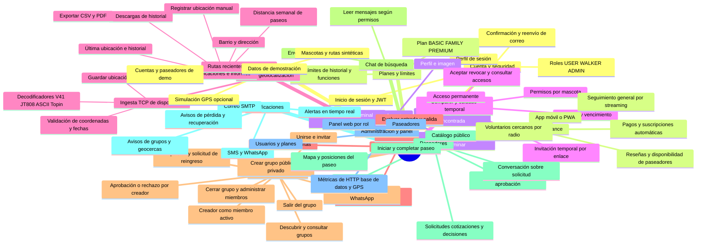

# Mapa mental de funcionalidades de FiruApp

Este mapa resume los módulos y funcionalidades identificados en el backend y el panel web de este repositorio. Describe el alcance actual observado en el código y la documentación; no implica que cada flujo haya sido validado en producción.

> **Alcance:** Transit vive en el proyecto Spring Boot hermano [Transit](../../transit/README.md) y no forma parte de este mapa de FiruApp.

## Mapa general

## Detalle por módulo

### 1. Cuenta y seguridad

- Registro de cuenta de usuario con correo, contraseña, nombre y teléfono. La contraseña se guarda con hash.
- Envío de enlace de confirmación por correo; se puede solicitar que se reenvíe. El acceso al sistema requiere verificar el correo.
- Inicio de sesión y emisión de JWT. El navegador conserva el token para llamar rutas protegidas.
- Roles principales: `USER` (dueño/usuario), `WALKER` (paseador) y `ADMIN` (administración).
- Consulta de la identidad actual, el rol, el plan y, si existe, el perfil de paseador.
- El cierre de sesión del panel elimina el token local; no revoca el JWT del lado servidor antes de su vencimiento.

Más detalle: [Autenticación y sesión](catalogo-requisitos.md#autenticación-y-sesión).

### 2. Planes y límites

- El backend maneja los planes `BASIC`, `FAMILY` y `PREMIUM`; administración puede asignar o cambiar el plan.
- Los límites actuales incluyen ventana de historial, personas con acceso, geocercas, grupos por cuenta y acceso temporal.
- CSV y PDF están sujetos a plan y permisos. El resumen semanal de distancia está disponible; la comparación mensual descrita en la oferta no está identificada como implementada.
- **No hay cobro ni ciclo automático de suscripción en este backend.** La asignación de un plan durante el registro no demuestra compra o pago.
- Hay decisiones comerciales pendientes sobre límites y efectos de cambio de plan, registradas en el catálogo.

Más detalle: [Planes y límites](catalogo-requisitos.md#planes-y-límites) y [planes comerciales documentados](planes-y-limites.md).

### 3. Gestión de mascotas

- Crear, listar, consultar, actualizar y eliminar perfiles de mascotas.
- Guardar datos del perfil e imagen; cargar la imagen al crear o actualizar.
- Asociar el identificador del dispositivo, distinguiendo `IMEI` de `terminalId`.
- Cambiar el estado de la mascota a perdida (`LOST`) o encontrada/activa (`ACTIVE`).
- El dueño administra su mascota; los permisos de otras personas dependen del tipo de acceso concedido.

Más detalle: [Mascotas](catalogo-requisitos.md#mascotas).

### 4. Compartir mascotas y cuidadores temporales

- **Acceso permanente:** compartir una mascota con una cuenta existente, consultar personas autorizadas y revocar un acceso.
- Las personas autorizadas pueden consultar recursos permitidos, pero no obtienen automáticamente permisos para editar la mascota o gestionar otros accesos.
- **Acceso temporal:** el dueño puede invitar un cuidador con fecha de inicio y fin y permisos seleccionados.
- El enlace se acepta mediante token; el acceso solo es efectivo cuando está aceptado, vigente y activo.
- El dueño puede listar o revocar accesos temporales. El vencimiento también se procesa automáticamente.
- Algunas funciones temporales, como horarios recurrentes, dependen del plan. Los permisos de ubicación, historial y alertas son conceptos separados.

Más detalle: [Acceso permanente compartido](catalogo-requisitos.md#acceso-permanente-compartido) y [Acceso temporal para cuidadores](catalogo-requisitos.md#acceso-temporal-para-cuidadores).

### 5. GPS, ubicación y recorridos

#### Dispositivos GPS e ingestión

- Recibir posiciones de collares por el listener TCP de Netty. El detector selecciona los decodificadores compatibles con V41/JT808, un formato ASCII acotado y Topin.
- Comprobar la identidad del terminal y procesar datos de posición y, cuando estén disponibles, porcentaje o voltaje de batería.
- Validar la marca de fix, coordenadas finitas y dentro de rango, antigüedad máxima de 10 minutos, adelanto máximo de 5 minutos y orden respecto a la última ubicación guardada.
- Enviar acuse positivo de ubicación después de persistirla o rechazarla intencionalmente; un fallo de escritura o saturación no recibe acuse positivo.

#### Ubicaciones e informes

- Registrar ubicación manual desde la API.
- Consultar última ubicación, historial según plan, ruta de las últimas tres horas y rutas entre fechas.
- Resolver dirección, barrio o comuna de una posición mediante el servicio de geocodificación configurado.
- Calcular distancia semanal con las posiciones de los paseos. Este resumen corresponde al paseo del perro y no a la ruta del collar GPS.
- Exportar historial en CSV o PDF según permisos y plan.
- Los límites de rutas y reportes pueden restringir la consulta; no representan una política de borrado del historial.

Consulta [Dispositivos GPS e ingestión](catalogo-requisitos.md#dispositivos-gps-e-ingestión) y [Ubicaciones e informes](catalogo-requisitos.md#ubicaciones-e-informes).

### 6. Geocercas y alertas

- Crear geocercas circulares con centro y radio, o poligonales a partir de coordenadas.
- Listar y eliminar geocercas de una mascota, sujetas a los permisos y límites del plan.
- Evaluar la posición contra las zonas seguras. La ubicación más reciente también se revisa al crear una nueva zona.
- Guardar alertas de geocerca cuando la posición está fuera de todas las zonas configuradas.
- Consultar alertas abiertas y cerrarlas conservando el registro.
- Avisar al dueño y, según el flujo configurado, a miembros activos de grupos vinculados a la mascota.

Más detalle: [Geocercas y alertas](catalogo-requisitos.md#geocercas-y-alertas).

### 7. Grupos de búsqueda y voluntarios

- Crear grupos asociados a una mascota accesible. Se permite crearlos para mascotas en cualquier estado; un grupo nuevo comienza `ACTIVE` y su creador queda como miembro activo.
- Definir visibilidad `PUBLIC` o `PRIVATE`. Los endpoints requieren autenticación aunque el grupo sea público.
- Descubrir grupos y consultar el detalle según permisos.
- Un usuario puede unirse a un grupo público activo. Los gestores pueden agregar miembros de acuerdo con la regla de permisos del grupo.
- Listar los grupos propios y ver voluntarios activos según permisos.
- Un voluntario puede salir voluntariamente; el creador no puede ser expulsado. Una expulsión deja la membresía revocada.
- Si un usuario revocado intenta volver, genera una solicitud pendiente. Se notifica al creador y solo este puede aprobar o rechazarla. Un grupo cerrado no acepta nuevas membresías.
- Solo el creador puede cambiar el estado entre `ACTIVE` y `CLOSED`.
- Los gestores pueden actualizar datos, imagen y enlace de WhatsApp del grupo, sujeto a permisos.
- La notificación de geocerca se dirige a miembros activos del grupo correspondiente; la búsqueda geográfica de voluntarios cercanos por radio no está implementada.

Más detalle: [Grupos de búsqueda](catalogo-requisitos.md#grupos-de-búsqueda) y [Notificaciones](catalogo-requisitos.md#notificaciones).

### 8. Chat de grupos de búsqueda

- Los miembros activos y los roles autorizados pueden consultar el historial del chat.
- Los mensajes se devuelven en orden ascendente y con paginación.
- Los participantes autorizados pueden enviar texto no vacío, hasta el límite definido por el servicio.
- La visibilidad pública del grupo no convierte el chat en público: pertenecer o tener permiso explícito sigue siendo necesario.

Más detalle: [Chat de búsqueda](catalogo-requisitos.md#chat-de-búsqueda).

### 9. Marketplace de paseadores y paseos

- Los visitantes consultan el catálogo de paseadores activos y aprobados; una persona puede solicitar un perfil de paseador.
- Administración puede listar, crear, aprobar, actualizar, desactivar o eliminar perfiles.
- Un dueño crea una solicitud con paseador, fecha, duración, presupuesto, dirección y, opcionalmente, mascota.
- Dueño y paseador consultan la solicitud, conversan y negocian; el paseador cotiza y el dueño acepta, rechaza o cancela.
- El paseador inicia el paseo acordado, envía posiciones durante la ejecución y lo marca como terminado.
- Los participantes consultan el estado, las posiciones y el recorrido del paseo en el mapa.
- No se procesa el pago del servicio desde este backend.

Más detalle: [Catálogo y administración de paseadores](catalogo-requisitos.md#catálogo-y-administración-de-paseadores), [Solicitudes y negociación de paseos](catalogo-requisitos.md#solicitudes-y-negociación-de-paseos) y [Ejecución de paseos](catalogo-requisitos.md#ejecución-de-paseos).

### 10. Notificaciones

- **Correo SMTP:** confirmación de cuenta y otros mensajes de la aplicación.
- **SMS y WhatsApp:** integración con Twilio, condicionada a la configuración disponible.
- **Tiempo real:** publicación de algunas alertas mediante WebSocket.
- **Mascota perdida/encontrada:** avisos asociados al cambio de estado.
- **Comunidad:** avisos por creación, ingreso, incorporación y solicitudes/decisiones de reingreso.
- **Geocercas:** avisos vinculados a la mascota y los grupos que correspondan.
- La notificación de voluntarios cercanos por distancia no está implementada; los avisos actuales no seleccionan usuarios por radio.

Más detalle: [Notificaciones](catalogo-requisitos.md#notificaciones).

### 11. Administración y clientes web

- Administración consulta usuarios, roles, planes y cantidad de mascotas.
- Administración de paseadores cubre perfiles y su estado de aprobación.
- El panel de métricas reúne contadores de HTTP, base de datos, conexiones Hikari e ingestión GPS; varios contadores son locales al proceso.
- El panel estático incluido en este repositorio brinda flujos de registro/sesión, vistas de dueño/paseador/admin, marketplace, solicitudes, conversación, mapa del paseo, grupos, alertas y métricas.
- El panel estático no representa todas las operaciones disponibles por API. La documentación menciona también un cliente React de otro repositorio; su alcance no se valida aquí.

Más detalle: [Administración y panel web](catalogo-requisitos.md#administración-y-panel-web).

### 12. Datos de demostración

- Crear perfiles y cuentas demo de paseadores de forma opcional/configurable.
- Preparar mascotas y recorridos sintéticos para la cuenta demo configurada.
- Simular posiciones GPS y alertas para mascotas de demostración sin afectar las mascotas reales.

Más detalle: [Datos de demostración](catalogo-requisitos.md#datos-de-demostración).

## Capacidades futuras o fuera de alcance

El catálogo también registra ideas que **no deben leerse como funcionalidades actuales**: pagos y suscripciones automáticas, reseñas de paseadores, disponibilidad horaria, incidencias y disputas, aplicación móvil o PWA, streaming general de posiciones, separación por organizaciones, inicio de sesión con proveedores externos y convocatoria geográfica de voluntarios cercanos.

Consulta: [Funcionalidades previstas o fuera del alcance actual](catalogo-requisitos.md#funcionalidades-previstas-o-expresamente-fuera-del-alcance-actual).
